# Mentoria — Database Design (ER Diagram, Draft 1)

Status: draft for team review (Fall Week 11). Database: PostgreSQL 16, built with Django models.
Each table below becomes one Django model in the app shown in brackets, e.g. `[accounts]`.

Notation: `PK` primary key, `FK` foreign key, `UK` unique. Crow's-foot lines: `||` exactly one, `o|` zero or one, `o{` zero or many, `|{` one or many.

```mermaid
erDiagram
    %% ---------- accounts ----------
    User {
        int id PK
        string email UK "used to log in"
        string username UK
        string password "hashed by Django"
        string first_name
        string last_name
        string role "student, educator, tutor, mentor, admin"
        string preferred_language "en or uz"
        bool is_active
        datetime date_joined
    }
    EducatorProfile {
        int user_id PK, FK
        text bio
        string expertise
    }

    %% ---------- bookings: profiles ----------
    TutorProfile {
        int user_id PK, FK
        text bio
        decimal hourly_rate
        string languages "array, e.g. en, uz, ru"
        string verification_status "pending, verified, rejected"
        decimal rating_avg "cached from reviews"
        int rating_count "cached from reviews"
    }
    TutorSubject {
        int id PK
        int tutor_id FK
        int subject_id FK
        string min_level
        string max_level
    }
    MentorProfile {
        int user_id PK, FK
        text bio
        string topics "career, study planning, applications"
        decimal default_price "0 means free"
        string languages "array"
        string verification_status "pending, verified, rejected"
        decimal rating_avg
        int rating_count
    }

    %% ---------- courses ----------
    Subject {
        int id PK
        string slug UK
        string name_en
        string name_uz
        bool uses_cefr "true for English (A1-C2)"
    }
    Course {
        int id PK
        int educator_id FK
        int subject_id FK
        string title
        text description
        string level
        string language "en, uz, ru"
        decimal price "0 means free"
        string status "draft, pending, approved, rejected"
        string rejection_reason
        datetime created_at
        datetime updated_at
    }
    Lesson {
        int id PK
        int course_id FK
        string title
        string lesson_type "video, pdf, quiz"
        int order "position inside the course"
        string video_file "media path, video lessons"
        string pdf_file "media path, pdf lessons"
        int duration_minutes
        bool is_free_preview
    }
    Enrollment {
        int id PK
        int student_id FK
        int course_id FK
        string status "pending_payment, active, cancelled"
        datetime enrolled_at
    }
    LessonProgress {
        int id PK
        int enrollment_id FK
        int lesson_id FK
        bool is_completed
        int quiz_score "percent, quiz lessons only"
        datetime completed_at
    }

    %% ---------- lectures ----------
    Lecture {
        int id PK
        int created_by_id FK
        int subject_id FK
        string title
        text description
        string language
        string lecture_type "recorded, live"
        string video_file "recorded only"
        datetime starts_at "live only"
        int duration_minutes
        string zoom_meeting_id "live only"
        string zoom_link "live only"
        string zoom_status "none, created, failed"
        bool is_published
        datetime created_at
    }
    LectureRegistration {
        int id PK
        int lecture_id FK
        int user_id FK
        datetime registered_at
    }

    %% ---------- bookings ----------
    AvailabilitySlot {
        int id PK
        int host_id FK "tutor or mentor user"
        datetime starts_at
        datetime ends_at
        decimal price "0 means free"
        bool is_active "host can withdraw an unbooked slot"
    }
    Booking {
        int id PK
        int slot_id FK
        int student_id FK
        int subject_id FK "tutor lessons only"
        string booking_type "tutor_lesson, mentor_consultation"
        string status "awaiting_payment, pending, confirmed, declined, cancelled, completed"
        decimal price "copied from slot at booking time"
        text student_note
        string zoom_meeting_id
        string zoom_link
        string zoom_status "none, created, failed"
        int cancelled_by_id FK
        datetime created_at
        datetime confirmed_at
    }
    Review {
        int id PK
        int booking_id FK, UK "one review per booking"
        int rating "1 to 5"
        text comment
        datetime created_at
    }

    %% ---------- placement ----------
    PlacementTest {
        int id PK
        int subject_id FK
        string title
        int question_count "questions per attempt"
        bool is_active
    }
    Question {
        int id PK
        int placement_test_id FK "set for placement questions"
        int lesson_id FK "set for quiz-lesson questions"
        text text
        int difficulty "1 easiest to 5 hardest"
        int order "quiz lessons only"
    }
    Choice {
        int id PK
        int question_id FK
        string text
        bool is_correct
    }
    PlacementAttempt {
        int id PK
        int student_id FK
        int placement_test_id FK
        int current_difficulty
        int score
        string status "in_progress, finished"
        datetime started_at
        datetime finished_at
    }
    AttemptAnswer {
        int id PK
        int attempt_id FK
        int question_id FK
        int choice_id FK
        bool is_correct
        datetime answered_at
    }
    StudentLevel {
        int id PK
        int student_id FK
        int subject_id FK
        string level "beginner/intermediate/advanced or A1-C2"
        int score
        datetime assessed_at
    }

    %% ---------- payments ----------
    Payment {
        int id PK
        int user_id FK "payer"
        int enrollment_id FK "set when paying for a course"
        int booking_id FK "set when paying for a session"
        decimal amount
        string currency
        string provider "stripe, fake"
        string provider_payment_id "Stripe PaymentIntent id"
        string status "pending, succeeded, failed, refunded"
        datetime created_at
        datetime paid_at
    }

    %% ---------- relationships ----------
    User ||--o| EducatorProfile : "has"
    User ||--o| TutorProfile : "has"
    User ||--o| MentorProfile : "has"
    TutorProfile ||--o{ TutorSubject : "teaches"
    Subject ||--o{ TutorSubject : "taught by"

    User ||--o{ Course : "creates (educator)"
    Subject ||--o{ Course : "categorises"
    Course ||--o{ Lesson : "contains"
    User ||--o{ Enrollment : "enrols (student)"
    Course ||--o{ Enrollment : "has"
    Enrollment ||--o{ LessonProgress : "tracks"
    Lesson ||--o{ LessonProgress : "tracked in"

    User ||--o{ Lecture : "publishes"
    Subject ||--o{ Lecture : "categorises"
    Lecture ||--o{ LectureRegistration : "has"
    User ||--o{ LectureRegistration : "registers"

    User ||--o{ AvailabilitySlot : "offers (tutor/mentor)"
    AvailabilitySlot ||--o{ Booking : "booked as"
    User ||--o{ Booking : "books (student)"
    Subject |o--o{ Booking : "topic of"
    Booking ||--o| Review : "reviewed in"

    Subject ||--o{ PlacementTest : "has"
    PlacementTest |o--o{ Question : "contains"
    Lesson |o--o{ Question : "quiz contains"
    Question ||--|{ Choice : "has"
    User ||--o{ PlacementAttempt : "takes"
    PlacementTest ||--o{ PlacementAttempt : "taken in"
    PlacementAttempt ||--o{ AttemptAnswer : "records"
    Question ||--o{ AttemptAnswer : "answered in"
    Choice ||--o{ AttemptAnswer : "chosen in"
    User ||--o{ StudentLevel : "has"
    Subject ||--o{ StudentLevel : "measured in"

    User ||--o{ Payment : "pays"
    Enrollment |o--o{ Payment : "paid by"
    Booking |o--o{ Payment : "paid by"
```

## Tables

### accounts
- **User**: one row per person who logs in. `role` decides what the API lets them do. It extends Django's `AbstractUser`, so it keeps the built-in password hashing, `is_staff` and so on.
- **EducatorProfile**: extra public info for educators. It is one-to-one with User and uses the user's id as its primary key.

### courses
- **Subject**: the shared list of subjects (Mathematics, English, …) with EN/UZ names. `uses_cefr` tells the system to use A1–C2 levels for that subject.
- **Course**: a course created by an educator. It stays hidden until an admin moves it from `pending` to `approved`. Price 0 means the course is free.
- **Lesson**: one ordered item in a course: a video, a PDF or a quiz. Files live in Django media storage and are served only after an enrolment check.
- **Enrollment**: the **many-to-many** link between students and courses. A paid course stays `pending_payment` until its Payment succeeds, then becomes `active`.
- **LessonProgress**: one row per lesson a student has opened or finished inside an enrolment. Course progress % = completed lessons / total lessons. It also stores the quiz score.

### lectures
- **Lecture**: a free open lecture. A recorded lecture has a video file and anyone can watch it. A live lecture has a start time and a Zoom link that the backend creates when the lecture is scheduled.
- **LectureRegistration**: the **many-to-many** link between users and live lectures. Only registered users can see the lecture's Zoom link.

### bookings
Tutor and mentor profiles live here (not in `accounts`), as CLAUDE.md says.
- **TutorProfile**: a tutor's public profile: rate, languages, admin verification status and a cached rating that is updated whenever a review is saved. Unverified tutors are not ranked.
- **TutorSubject**: the **many-to-many** link between tutors and subjects. It also stores the level range the tutor teaches in each subject, which the "level fit" part of matching uses.
- **MentorProfile**: a mentor's public profile: advice topics, a default session price (0 means free), languages and verification status.
- **AvailabilitySlot**: one bookable time block offered by a tutor or mentor. The UI's "weekly availability" form creates these rows for the next few weeks. `price` comes from the tutor's hourly rate or the mentor's chosen price.
- **Booking**: a student's request for a slot, either a tutor lesson or a mentor consultation, in one shared table. It goes through the status flow (`awaiting_payment` → `pending` → `confirmed` → `completed`, or `declined` / `cancelled`). Once confirmed, it stores the Zoom link. `zoom_status = failed` marks bookings to retry.
- **Review**: a 1–5 rating and comment for a completed booking. The unique `booking_id` enforces "one review per booking". Who wrote it and who it is about both come from the booking.

### placement
- **PlacementTest**: the adaptive test for one subject, e.g. "English placement". `question_count` sets how many questions one attempt asks.
- **Question**: one multiple-choice question with a difficulty from 1 to 5. The same table serves placement tests and quiz lessons: exactly one of `placement_test_id` or `lesson_id` is filled in.
- **Choice**: one answer option for a question. `is_correct` marks the right one(s). It is never sent to the student's browser.
- **PlacementAttempt** *(added)*: one run of a placement test. It stores `current_difficulty` so the server can pick a harder or easier next question after each answer.
- **AttemptAnswer** *(added)*: each answer given in an attempt. It is used to avoid repeating questions and to calculate the final score.
- **StudentLevel**: a student's current level in one subject, the result of their latest finished attempt. It drives course recommendations and tutor ranking.

### payments
- **Payment**: one payment attempt, made through Stripe test mode or the fake provider. It is linked to exactly one Enrollment or one Booking. Several failed attempts can exist before one succeeds, so the link is one-to-many.

## Constraints that protect the data

| Rule | How it is enforced |
|---|---|
| A slot is never double-booked | Partial unique index on `Booking(slot_id)` where status is `awaiting_payment`, `pending`, `confirmed` or `completed`, plus `select_for_update()` inside a transaction. Declined or cancelled bookings free the slot again. |
| A host's slots don't overlap | Overlap check in a transaction when a slot is created (`new.starts_at < old.ends_at AND new.ends_at > old.starts_at`). |
| One enrolment per student per course | Unique `(student_id, course_id)` on Enrollment |
| One progress row per lesson | Unique `(enrollment_id, lesson_id)` on LessonProgress |
| One registration per live lecture | Unique `(lecture_id, user_id)` on LectureRegistration |
| One level per student per subject | Unique `(student_id, subject_id)` on StudentLevel (updated after each new attempt) |
| One review per booking | Unique `booking_id` on Review |
| Tutor lists each subject once | Unique `(tutor_id, subject_id)` on TutorSubject |
| Lesson order is unique | Unique `(course_id, order)` on Lesson |
| Question belongs to exactly one owner | Check: exactly one of `placement_test_id` / `lesson_id` is filled in |
| Payment pays for exactly one thing | Check: exactly one of `enrollment_id` / `booking_id` is filled in |
| Valid values | Check constraints: `rating` 1–5, `difficulty` 1–5, `price >= 0`, `ends_at > starts_at` |

## Design choices to confirm

1. **Concrete slots, not a repeating weekly rule.** Each AvailabilitySlot has a real date and time, and the weekly form generates rows for the next N weeks. This makes double-booking checks a simple unique index.
2. **Levels as a fixed list (choices), not a table.** Values are `beginner`, `intermediate`, `advanced`, `A1`–`C2`. Matching code maps them to numbers for "level fit".
3. **Languages as a PostgreSQL array** on Tutor/MentorProfile (`django.contrib.postgres`, part of Django, so no new library), not a separate Language table.
4. **Quiz lessons reuse Question/Choice** instead of having their own copy of those tables.
5. **Budget and schedule for matching come from the search filters** the student enters, so there is no extra table for student preferences.
6. **Not included yet:** a `Report` table for FR-ADM-03 / US-16, which is "Could" priority. It can be added later without changing anything above.
